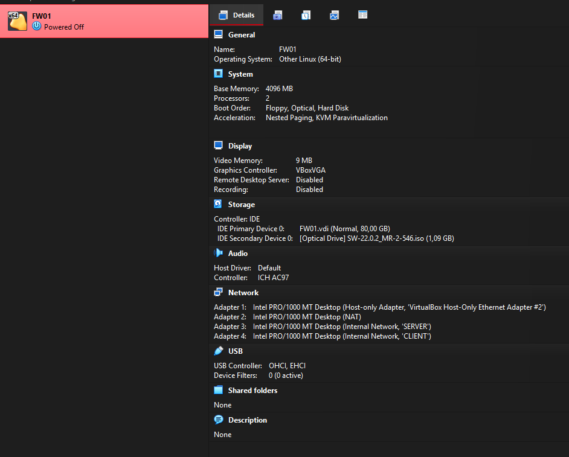
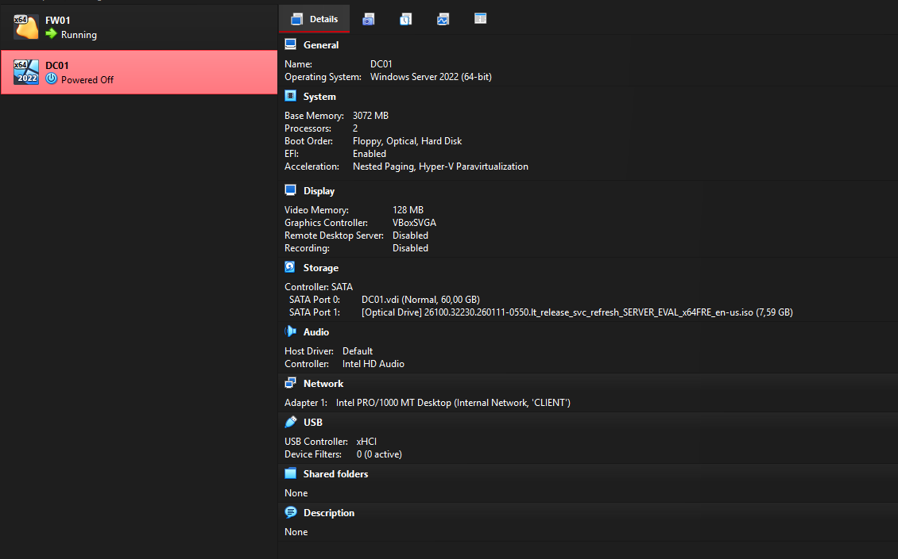
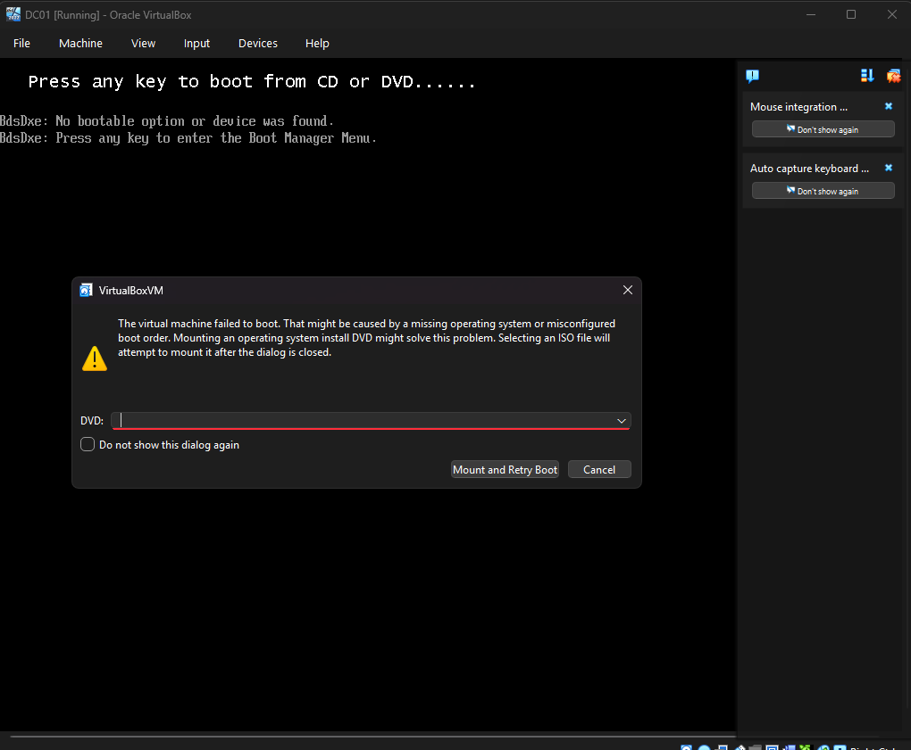

# 01 - VirtualBox setup

## Goal

Prepare the virtualization host and the first two VMs (FW01, DC01) so that every lab VM reaches the internet only through the Sophos firewall, and the host stays outside the lab networks.

## Host

| Item | Value |
| --- | --- |
| OS | Windows 11 Home |
| CPU / RAM | 8 cores / 16 threads, 32 GB |
| Hypervisor | Oracle VirtualBox |
| VM folder | `D:\VMs VirtualBox\` |

**Why VirtualBox:** the original plan was VMware Workstation Pro. The Broadcom download account stayed in "Account verification is pending" after the trade compliance form. VirtualBox needs no account, supports vTPM and Secure Boot for Windows 11 without VM encryption, and makes isolated networks simple. Hyper-V is not available on Windows 11 Home.

## Networks

| Name | VirtualBox type | Subnet | Notes |
| --- | --- | --- | --- |
| NAT | NAT | assigned by VirtualBox | WAN of FW01 only |
| VirtualBox Host-Only Ethernet Adapter #2 | Host-only | 172.16.16.0/24, host 172.16.16.1 | DHCP disabled; used only to reach the Sophos web admin |
| `SERVER` | Internal network | 10.10.10.0/24 | Servers |
| `CLIENT` | Internal network | 10.10.20.0/24 | Clients |

Internal networks are created simply by typing their name in the adapter settings. They have no DHCP and no connection to the host.

### Create the host-only management network

1. VirtualBox Manager: switch to **Expert Mode**.
2. **File → Tools → Network Manager → Host-only Networks → Create**.
3. Adapter: IPv4 `172.16.16.1`, mask `255.255.255.0`.
4. DHCP server: disabled.

## VM: FW01

| Setting | Value |
| --- | --- |
| Type / Version | Linux / Other Linux (64-bit) |
| Unattended installation | Skipped |
| Memory / CPUs | 4096 MB / 2 |
| Disk | 80 GB VDI, dynamically allocated |
| EFI | Disabled (Sophos Firewall Home does not support UEFI) |
| Adapter 1 | Host-only #2 → Sophos Port1 (LAN/MGMT) |
| Adapter 2 | NAT → Sophos Port2 (WAN) |
| Adapter 3 | Internal network `SERVER` → Port3 |
| Adapter 4 | Internal network `CLIENT` → Port4 |
| Adapter type (all) | Intel PRO/1000 MT Desktop (82540EM) |

The adapter order matters: Sophos maps VirtualBox adapter 1 to Port1 and adapter 2 to Port2.



## VM: DC01

| Setting | Value |
| --- | --- |
| ISO | Windows Server 2025 Evaluation, English (build 26100) |
| Edition | Windows Server 2025 Standard Evaluation (Desktop Experience) |
| Unattended installation | Skipped |
| Memory / CPUs | 3072 MB / 2 |
| Disk | 60 GB VDI, dynamically allocated, SATA |
| EFI | Enabled |
| Adapter 1 | Internal network `SERVER`, Intel PRO/1000 MT Desktop |



Desktop Experience instead of Server Core: Microsoft Entra Connect, planned for block 4, is not supported on Server Core.

### Post-install configuration

1. Install VirtualBox Guest Additions: **Devices → Insert Guest Additions CD image**, then in an elevated PowerShell:

   ```powershell
   D:\VBoxWindowsAdditions.exe
   ```

2. Enable **Devices → Shared Clipboard → Bidirectional** and restart the VM.
3. Network, time zone and host name (elevated PowerShell):

   ```powershell
   New-NetIPAddress -InterfaceAlias "Ethernet" -IPAddress 10.10.10.10 -PrefixLength 24 -DefaultGateway 10.10.10.1
   Set-DnsClientServerAddress -InterfaceAlias "Ethernet" -ServerAddresses 1.1.1.1
   Set-TimeZone -Id "W. Europe Standard Time"
   Rename-Computer -NewName "DC01" -Restart
   ```

   DNS `1.1.1.1` is temporary. After AD DS is installed, DC01 uses itself for DNS and 1.1.1.1 becomes a forwarder.

## Verification

| Check | Result |
| --- | --- |
| `hostname` on DC01 | `DC01` |
| `ipconfig` on DC01 | 10.10.10.10/24, gateway 10.10.10.1 |
| Internet from DC01 through FW01 | Works (see [02 - Sophos Firewall](02-sophos-firewall.md)) |

## Snapshots

| VM | Snapshot | Taken after |
| --- | --- | --- |
| FW01 | `FW01-fw22.0.3(aktuell)` | First successful boot on SFOS 22.0.3, before the base configuration |
| FW01 | `FW01-base` | Zones, interfaces, temporary rule and NAT configured |
| DC01 | `DC01-prepared` | IP, time zone, host name |
| DC01 | `DC01-online` | Internet through FW01 verified |

Rule: at most two snapshots per VM; delete old ones after the next one is verified.

## Troubleshooting

| Problem | Cause | Solution |
| --- | --- | --- |
| VMware download blocked: "Account verification is pending" | Broadcom trade compliance screening of a new account | Switched to VirtualBox instead of waiting |
| New VM not visible after creation | VirtualBox Manager showed the Welcome page instead of the machine list | Expert Mode, open the machine list; alternatively **Open** the `.vbox` file |
| FW01 created as 32-bit "Other/Unknown" | Default OS type | Changed to Linux / Other Linux (64-bit) |
| Network adapters were PCnet-FAST III | Default for the selected OS type | Changed all adapters to Intel PRO/1000 MT Desktop |
| DC01: "No bootable option or device was found" | The UEFI prompt "Press any key to boot from CD or DVD" timed out | Remounted the ISO, retried the boot and pressed a key immediately |
| Clipboard sharing did not work | Guest Additions were installed with "reboot later" | Restarted the VM |
| Turtle icon in the VM status bar | Hyper-V related features are active on the host, so VirtualBox runs through the Windows Hypervisor Platform (slower) | Left as is for now; documented as a known performance limitation |

UEFI boot error on DC01 after the boot prompt timed out:


