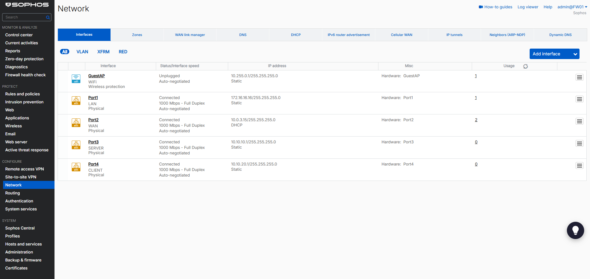
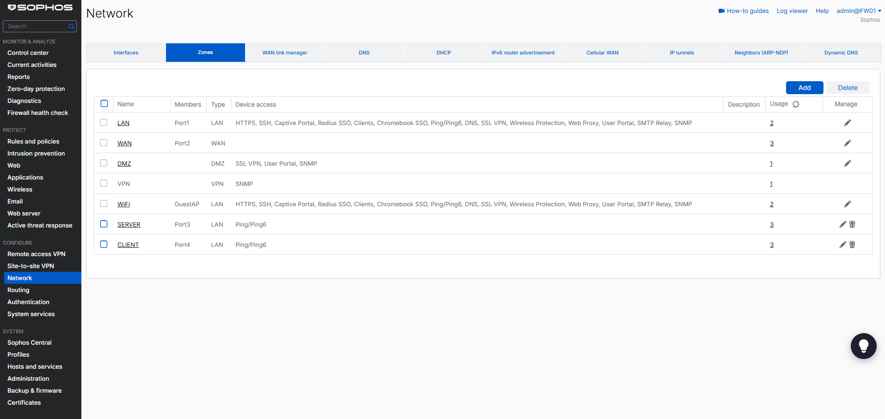
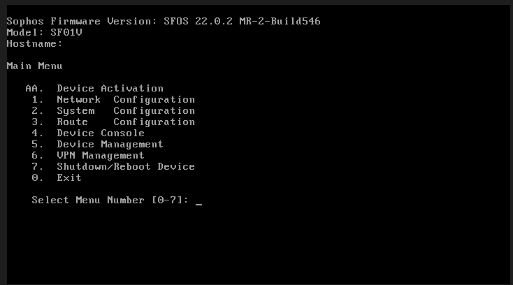
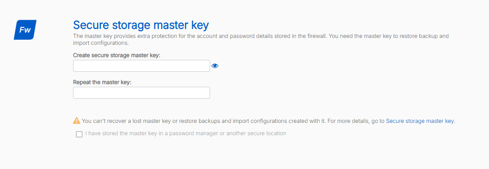
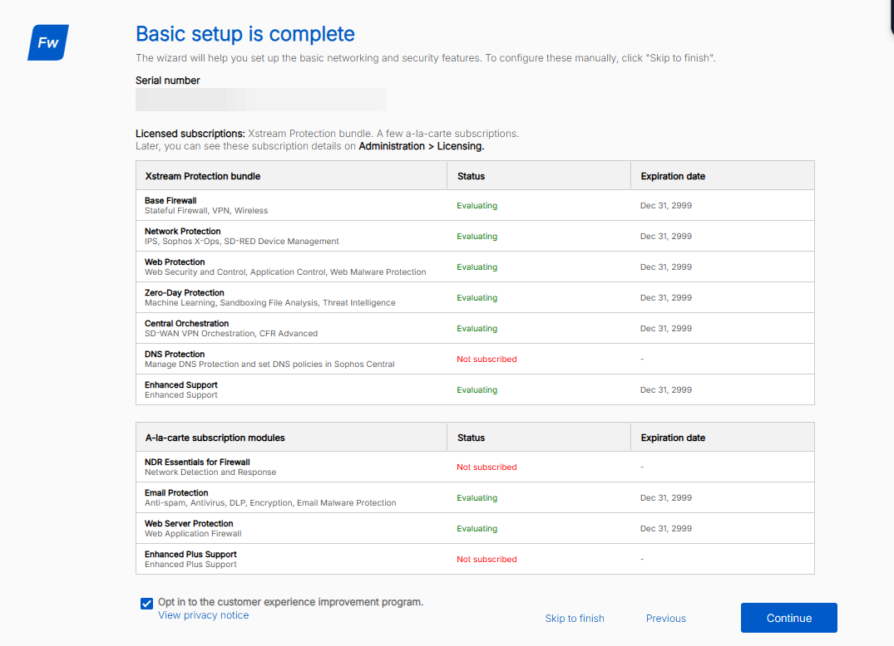
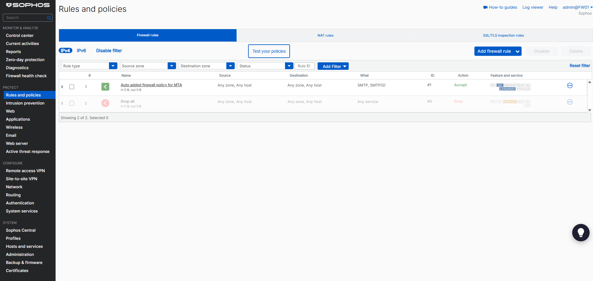
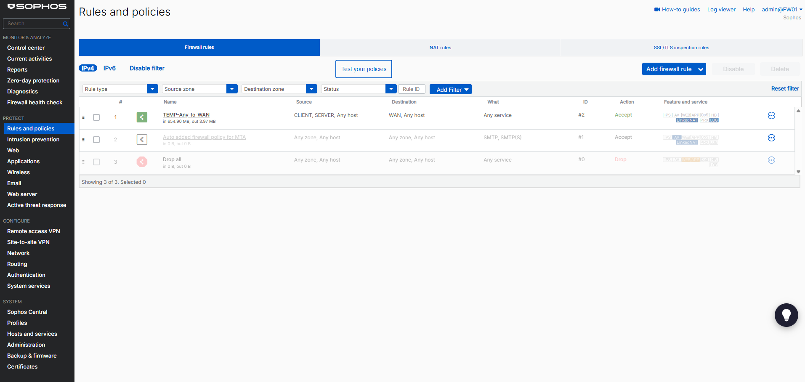
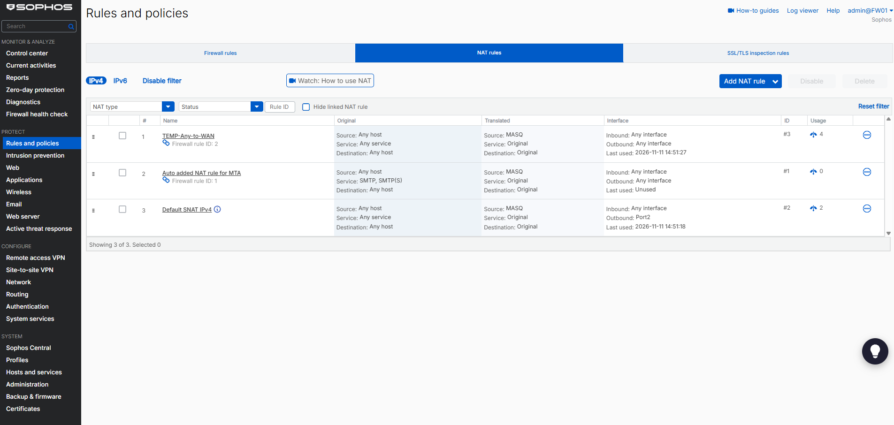
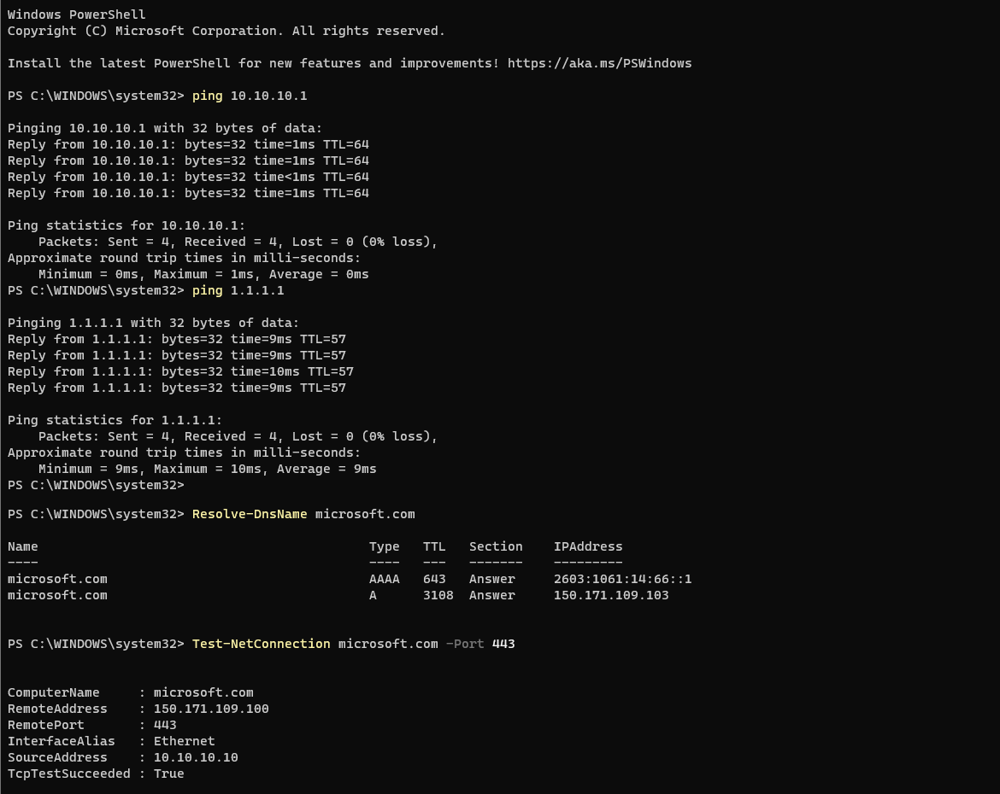
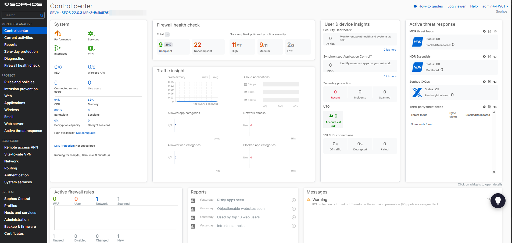

# 02 - Sophos Firewall

## Goal

Run all lab traffic through a next-generation firewall, split the lab into zones and allow only the traffic that is needed. This document covers the installation and the base configuration; the strict rule set, DHCP relay, web filter and remote access VPN follow in part 2.

## Version and license

| Item | Value |
| --- | --- |
| Product | Sophos Firewall Home Edition (free for home and lab use) |
| Installed from | `SW-22.0.2_MR-2-546.iso` |
| Running version | SFOS 22.0.3 MR-3 build 576 (updated automatically by the setup wizard) |
| License | Home license, registered with the serial number from Sophos |

## Interfaces and zones

| Port | VirtualBox adapter | Zone | IP address | Purpose |
| --- | --- | --- | --- | --- |
| Port1 | Host-only #2 | LAN | 172.16.16.16/24 | Web admin from the host (`https://172.16.16.16:4444`) |
| Port2 | NAT | WAN | DHCP from VirtualBox | Internet |
| Port3 | Internal `SERVER` | SERVER | 10.10.10.1/24 | Gateway for servers |
| Port4 | Internal `CLIENT` | CLIENT | 10.10.20.1/24 | Gateway for clients |

Zones `SERVER` and `CLIENT` were created as type LAN with device access limited to Ping/Ping6.





The default `LAN` zone (Port1, management) still allows many device services: HTTPS, SSH, captive portal, SSL VPN, web proxy, SMTP relay, SNMP and more. Only HTTPS and SSH are needed for administration, so this is restricted in part 2. The default `GuestAP` Wi-Fi interface is unused.

## Installation

1. Boot FW01 from the ISO and confirm the installation (the virtual disk is wiped).
2. Remove the ISO before the reboot (**Devices → Optical Drives → Remove disk**), otherwise the installer starts again.
3. After the reboot the console shows the main menu; Port1 has the default address 172.16.16.16.



## Initial setup wizard

1. Open `https://172.16.16.16:4444` from the host and accept the self-signed certificate warning.
2. Set the admin password. It must contain upper- and lowercase letters, digits and special characters; otherwise the wizard does not continue and shows no clear error.
3. Create the secure storage master key. It encrypts stored credentials and is required to restore backups. It cannot be recovered, so it is stored in a password manager.

   

4. Register the firewall with the Home license serial number. The Xstream Protection bundle shows "Evaluating" with an expiry date of 31 Dec 2999, which is how the Home license appears.

   

5. **Skip to finish** instead of the networking part of the wizard: zones, interfaces and rules are configured manually.

The wizard downloaded and installed firmware 22.0.3 automatically, even though the option was unchecked on the first page.

## Configuration

### Zones and interfaces

1. **Configure → Network → Zones → Add**: `SERVER` and `CLIENT`, type LAN, device access Ping/Ping6.
2. **Configure → Network → Interfaces**: Port3 → zone SERVER, static `10.10.10.1/24`; Port4 → zone CLIENT, static `10.10.20.1/24`.

### Firewall rules

| # | Rule | Source | Destination | Service | Action | Notes |
| --- | --- | --- | --- | --- | --- | --- |
| 1 | `TEMP-Any-to-WAN` | SERVER, CLIENT | WAN | Any | Accept, logged | Temporary; replaced by strict rules in part 2 |
| 2 | Auto added firewall policy for MTA | Any zone | Any zone | SMTP, SMTPS | Disabled | Created automatically for the email module; an any-to-any rule is not needed in this lab |
| - | Drop all | Any | Any | Any | Drop | Default rule at the bottom |

Before (default rules after setup):



After (temporary internet rule added, MTA rule disabled):



### NAT

| Rule | Translation | Notes |
| --- | --- | --- |
| Linked NAT for `TEMP-Any-to-WAN` | Source → MASQ | Removed together with the temporary rule |
| Default SNAT IPv4 | Source → MASQ, outbound Port2 | Default masquerading to WAN |



## Verification (from DC01)

```powershell
ping 10.10.10.1
ping 1.1.1.1
Resolve-DnsName microsoft.com
Test-NetConnection microsoft.com -Port 443
```

| Check | Result |
| --- | --- |
| Gateway 10.10.10.1 | Reachable |
| Internet (1.1.1.1) | Reachable |
| DNS resolution | Works |
| HTTPS to microsoft.com | `TcpTestSucceeded : True` |
| NAT rule usage counter | Increasing for `TEMP-Any-to-WAN` |



After setup the control center shows the firewall running on SFOS 22.0.3 with 22 noncompliant policies in the firewall health check:



## Troubleshooting

| Problem | Cause | Solution |
| --- | --- | --- |
| Ping to 172.16.16.16 worked, web admin did not open | Web services start several minutes after the console is ready | Checked with `Test-NetConnection 172.16.16.16 -Port 4444` and waited |
| "Continue" did nothing on the password page | Password did not meet the complexity requirements | Used a password with all four character types |
| First boot after the firmware update hung at "Booting '22_0_3_576'" for about 25 minutes, one vCPU at 100 % | Unclear; the firmware itself had already been written | **Machine → Reset**; the second boot reached the console menu |
| Web admin slow, CPU around 94 % after boot | Signature and pattern updates after the first start | Waited; considering 4 vCPUs (the Home license uses up to 4 cores) |

## Next steps (part 2)

1. ~~DHCP relay from CLIENT to DC01.~~ Done in block 3, see [03 - Active Directory foundation](03-active-directory.md#dhcp-relay).
2. Strict rules instead of `TEMP-Any-to-WAN`: ~~CLIENT → SERVER only AD services~~ (done in block 3: rule `CLIENT-to-DC01`, service group `AD-Client`); CLIENT → WAN only HTTP/HTTPS with web filtering; SERVER → WAN only HTTPS, plus DNS and NTP for DC01.
3. Web filter policy for CLIENT with one exception handled as a change ticket.
4. Remote access VPN (Sophos Connect), VPN pool 10.10.99.0/24.
5. Review and fix the Firewall health check findings (22 noncompliant policies after setup).
6. IPS: currently off, enable together with the strict rules.
7. Restrict device access of the default `LAN` zone (management) to HTTPS, SSH and Ping.
