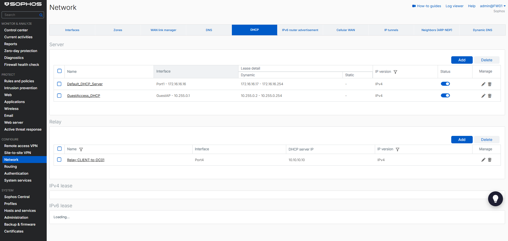
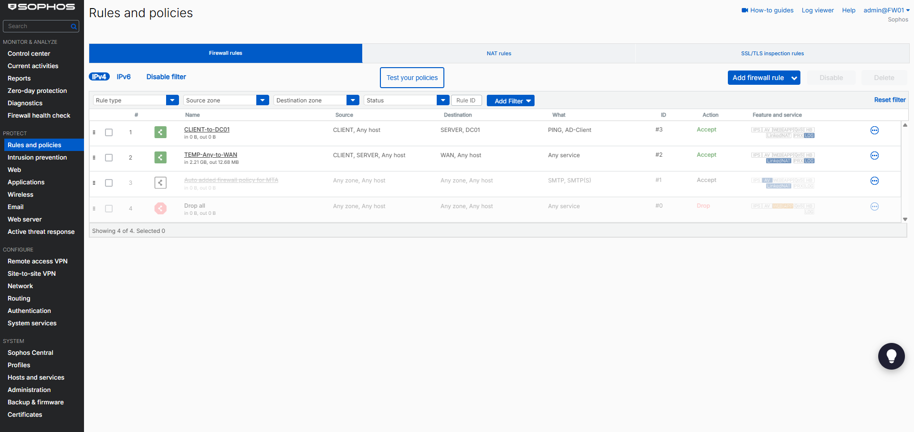
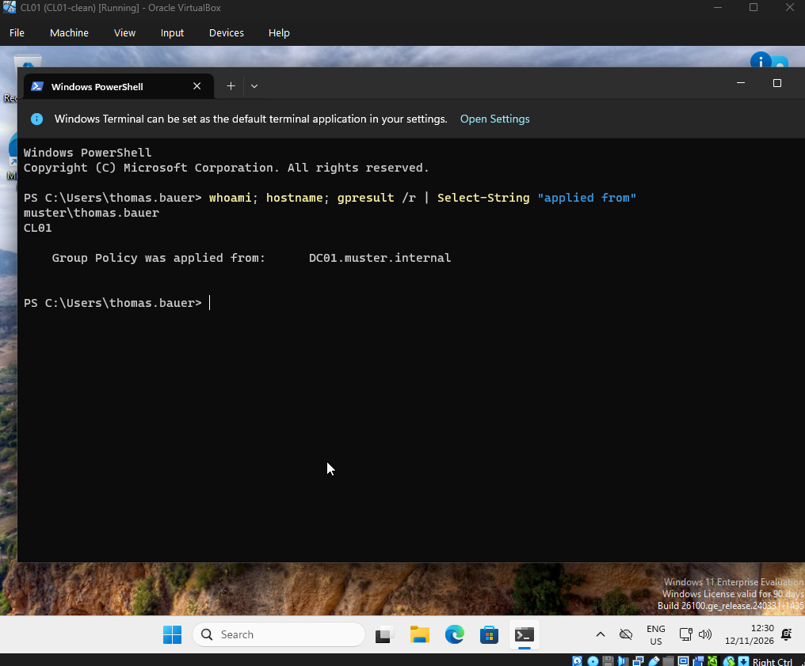

# 03 - Active Directory foundation

## Goal

Build the on-premises identity that block 4 synchronizes to Microsoft Entra ID: a single-domain forest on DC01 with DNS and DHCP, an OU structure for "Muster GmbH", 20 users in four departments and a Windows 11 client joined to the domain. All traffic between the client and the domain controller passes through the Sophos firewall and is limited to the ports Active Directory needs.

**Done when:** a domain user signs in on CL01 and the scripts are in this repository.

## Result

| Item | Value |
| --- | --- |
| Forest / domain | `muster.internal` (NetBIOS `MUSTER`), single domain |
| Domain controller | DC01, 10.10.10.10, AD DS + DNS + DHCP |
| DNS | Loopback on DC01, forwarders 1.1.1.1 and 1.0.0.1, reverse zones for 10.10.10.0/24 and 10.10.20.0/24 |
| Time | PDC emulator syncs from `0.at.pool.ntp.org` / `1.at.pool.ntp.org` |
| DHCP | Scope `CLIENT` 10.10.20.100-199, router 10.10.20.1, DNS 10.10.10.10, lease 8 days, via Sophos DHCP relay |
| Users | 20 in four departments, admin account in a separate OU |
| Client | CL01, Windows 11 Enterprise Evaluation, joined to the domain |

Why `.internal` and not `.local`: `.internal` is reserved for private use and never resolves on the internet; `.local` conflicts with multicast DNS (Bonjour, Avahi).

## Domain controller

Scripts: [`scripts/`](../scripts/README.md). Files were copied from the host to DC01 through a read-only VirtualBox shared folder and then to `C:\Scripts`, so the VM does not depend on the share during reboots.

1. **Before promotion:** time zone set to `W. Europe Standard Time` and the clock checked. Kerberos rejects authentication if client and DC differ by more than 5 minutes. Snapshot taken.
2. **`01-Install-ADForest.ps1`:** installs AD DS and DNS, creates the forest and reboots. The DSRM password (Directory Services Restore Mode, used for offline recovery of AD) is stored in a password manager.
3. **`02-Configure-DNS-Time.ps1`:**
   - DNS client of DC01 points to `127.0.0.1`. The DC resolves its own zone instead of a public resolver, which does not know `muster.internal`.
   - Forwarders 1.1.1.1 and 1.0.0.1 resolve internet names.
   - Reverse zones and a PTR record for DC01 (needed for clean `nslookup` output and some diagnostic tools).
   - The PDC emulator is the time source of the domain, so it syncs from an external NTP pool. Clients sync from the DC automatically.
4. **`03-Configure-DHCP.ps1`:** installs DHCP, authorizes the server in AD (an unauthorized Windows DHCP server in a domain does not hand out leases) and creates the scope for the CLIENT network.

### Checks

```powershell
w32tm /query /status                                       # Source: 0.at.pool.ntp.org
Resolve-DnsName microsoft.com                              # forwarders work
Resolve-DnsName _ldap._tcp.dc._msdcs.muster.internal -Type SRV   # clients can find the DC
Get-DhcpServerv4Scope                                      # scope CLIENT, State Active
```

All four returned the expected result.

## OU structure, groups and users

```
muster.internal
└── Muster
    ├── Benutzer
    │   ├── Geschäftsführung   2 users
    │   ├── Buchhaltung        5 users
    │   ├── Vertrieb           9 users
    │   └── IT                 4 users
    ├── Computer               CL01 (default for new computers via redircmp)
    ├── Gruppen                GG-Geschaeftsfuehrung, GG-Buchhaltung, GG-Vertrieb, GG-IT
    └── Admins                 adm-timur
```

Design decisions:

- **Own OU tree under `Muster`** instead of the default `Users` and `Computers` containers: group policies cannot be linked to containers, and block 4 synchronizes only `Benutzer` and `Computer` to Entra ID.
- **`redircmp`** makes `Muster/Computer` the default location for new computer objects, so a domain join without an OU path does not end up in `Computers`.
- **Security groups per department** (`GG-` = global group): permissions are assigned to groups, not to users.
- **Attribute `Department`** is set for every user. Block 5 uses it for dynamic groups in Entra ID (`department -eq "Buchhaltung"`).
- **Separate admin account** `adm-timur` in `Admins`, member of Domain Admins. Daily work and administration are separated; the `Admins` OU is not synchronized to the cloud.
- **UPN suffix** is still `@muster.internal`. It is switched to the tenant domain with `06-Set-UpnSuffix.ps1` once the Microsoft 365 trial exists, so cloud and on-premises sign-in names match.
- New users must change the initial password at first sign-in.

## Firewall changes for the domain

Without these changes CL01 gets no IP address and cannot reach the DC: broadcasts do not cross the firewall, and the default rule drops all traffic between zones.

### DHCP relay

**Configure → Network → DHCP → Relay:** `Relay-CLIENT-to-DC01`, interface Port4, DHCP server 10.10.10.10.

A client without an address sends a DHCP broadcast. Sophos receives it on Port4 and forwards it to DC01 as unicast with `giaddr` = 10.10.20.1. From that address DC01 selects the scope 10.10.20.0/24. This is the same mechanism as `ip helper-address` on Cisco devices.



### Service group `AD-Client`

| Protocol | Port | Service |
| --- | --- | --- |
| TCP, UDP | 53 | DNS |
| TCP, UDP | 88 | Kerberos |
| UDP | 123 | NTP |
| TCP | 135 | RPC endpoint mapper |
| TCP, UDP | 389 | LDAP |
| TCP | 445 | SMB (SYSVOL, group policies) |
| TCP, UDP | 464 | Kerberos password change |
| TCP | 636 | LDAPS |
| TCP | 3268-3269 | Global catalog |
| TCP | 49152-65535 | Dynamic RPC |

### Rule `CLIENT-to-DC01`

| Field | Value |
| --- | --- |
| Position | 1, above `TEMP-Any-to-WAN` |
| Source | Zone CLIENT, any host |
| Destination | Zone SERVER, host DC01 (10.10.10.10) only |
| Services | `AD-Client`, Ping |
| Action | Accept, logged |
| NAT | None; internal traffic keeps the real client IP, which keeps DC logs useful |



## CL01

### Virtual machine

| Setting | Value | Reason |
| --- | --- | --- |
| OS | Windows 11 Enterprise Evaluation, build 26100 (English) | 90-day evaluation |
| vCPU / RAM | 2 / 4 GB | Windows 11 setup refuses less than 4 GB |
| Disk | 64 GB dynamic | |
| Firmware | EFI, Secure Boot, TPM 2.0 | Windows 11 requirements; later BitLocker and Intune compliance |
| Graphics | VMSVGA, 128 MB, no 3D acceleration | Recommended controller for Windows guests |
| Network | Adapter 1 only: Internal network `CLIENT`, Intel PRO/1000 MT Desktop | Client reaches everything only through FW01; a second NAT adapter would bypass the firewall |

### Installation and domain join

1. OOBE: **Sign-in options → Domain join instead**, local account `localadmin` as an emergency login if the domain is unavailable. Reaching this screen already confirmed that DHCP through the relay and internet access worked.
2. Network checks before the join:

   ```powershell
   ipconfig /all                              # 10.10.20.1xx, DHCP server and DNS 10.10.10.10
   Resolve-DnsName muster.internal
   Test-NetConnection 10.10.10.10 -Port 389   # TcpTestSucceeded : True
   ```

3. Domain join with `adm-timur`. What happens: CL01 finds the DC through the DNS SRV record, creates a computer object in `OU=Computer,OU=Muster` and sets up a machine password with the domain (secure channel). Domain Admins become local administrators, Domain Users local users.
4. Rename to `CL01` with `Rename-Computer -DomainCredential`, which renames the AD object as well. See troubleshooting: join and rename in one command failed. [`07-Join-CL01.ps1`](../scripts/07-Join-CL01.ps1) now renames first and joins in a second run.

### Verification

Signed in on CL01 as `MUSTER\thomas.bauer`, initial password changed:

```powershell
whoami                    # muster\thomas.bauer
hostname                  # CL01
gpresult /r               # Group Policy was applied from: DC01.muster.internal
```



## Updates

| VM | Approach |
| --- | --- |
| DC01 | Updated with Windows Update after block 3. Entra Connect / Cloud Sync in block 4 needs a current system (.NET, TLS 1.2). |
| CL01, CL02 | Not updated manually. Client patching is part of block 6 (Intune update rings) and block 8 (Action1); ticket 15 depends on missing updates. |
| FW01 | SFOS 22.0.3 MR-3 (block 2). |

## Snapshots

| VM | Snapshot | State |
| --- | --- | --- |
| DC01 | `DC01-adds-ready` | Forest, DNS, DHCP, OUs and users configured |
| CL01 | `CL01-joined` | Joined to the domain as CL01 |

## Troubleshooting

| Problem | Cause | Solution |
| --- | --- | --- |
| DC01 clock about 18 hours behind the host | Default time zone (Pacific) and clock state from an older snapshot; would break Kerberos later | `Set-TimeZone -Id "W. Europe Standard Time"`, `w32tm /resync`, VirtualBox host time sync left enabled until NTP worked |
| Script did nothing when started from the context menu | "Run with PowerShell" closes the window immediately, errors are not visible | Run scripts from an open elevated PowerShell window with `.\script.ps1` |
| `02`: `Resolve-DnsName : DNS server failure`, `w32tm`: no time data | FW01 was not running, so DC01 had no internet access | Started FW01, ran the checks again |
| `02` failed on a second run with error 9711 | PTR record already existed; `-ErrorAction SilentlyContinue` does not suppress this CIM error | Script now checks for the record first |
| User `andrea.huber` skipped by `05`, then found disabled, without password and group | An earlier aborted run had created the object; `New-ADUser` creates the account before it sets the password | Reset password, enabled the account, added to the group; script now warns about disabled existing accounts |
| CL01 did not boot after the first start | "Press any key to boot from CD" was missed | **Machine → Reset**, key pressed in time |
| `Add-Computer`: "More data is available" | Typo in `-OUPath` (missing `DC=muster`); the OU did not exist | Corrected path |
| `Add-Computer`: joined, but "renaming it to 'CL01' failed ... The directory service is busy" | Join and rename in one call; the second change reached AD while the first was still being processed | Reboot, then `Rename-Computer -NewName CL01 -DomainCredential MUSTER\adm-timur -Restart` |
| Black screen after the reboot following the domain join, no disk activity | Unclear | **Machine → Reset**; normal boot afterwards |
| Shared clipboard between host and CL01 did not work | Not resolved yet | Commands typed manually |

## Next steps

1. Disable VirtualBox host time sync for DC01 (`GetHostTimeDisabled 1`), so only NTP sets the clock of the PDC.
2. Remove the VirtualBox shared folder from DC01 to keep the lab isolated from the host.
3. Block 2 part 2: replace `TEMP-Any-to-WAN` with strict rules. DC01 then needs DNS (53) and NTP (123) to the internet in addition to HTTPS.
4. Block 4 (from 16 Nov 2026): Microsoft 365 trial, `06-Set-UpnSuffix.ps1`, Entra Connect / Cloud Sync, hybrid join of CL01.
